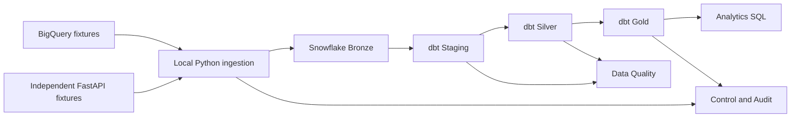
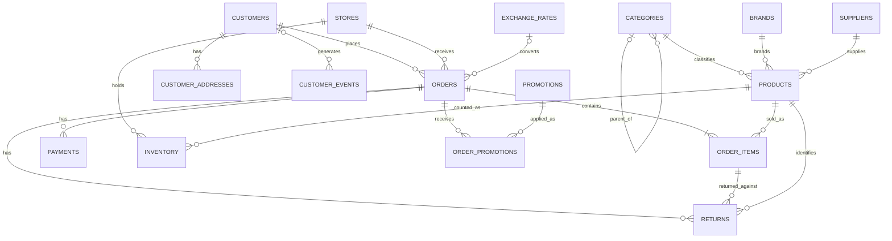

# Architecture

The retail business needs consistent answers across checkout channels. Order lines describe what sold, payment attempts describe money movement, and returns describe units returned and refunds requested or completed. Joining those datasets directly at order level can multiply revenue whenever an order has several lines, payments or returns.

## Snowflake layout

| Schema in RETAIL_DWH | Responsibility |
| --- | --- |
| BRONZE | Raw payload in VARIANT plus source, entity, source ID, timestamps, payload hash, batch and run IDs |
| STAGING | Source-specific parsing, casting, flattening and provenance |
| SILVER | Standardized entities, deduplication, history inputs and trusted child records |
| GOLD | Conformed dimensions, grain-specific facts and business aggregates |
| CONTROL | Entity configuration references, checkpoints, watermarks and replay state |
| DATA_QUALITY | Rule results, quarantined payloads and remediation state |
| AUDIT | Pipeline and table runs, errors, transformations and reconciliation |

One development database with separate schemas keeps object grants and navigation manageable. Production can isolate environments and ownership in separate databases or accounts and give ingestion and transformation separate compute.

## Transfer and failure model

Python will read paged BigQuery query results using Application Default Credentials and fetch API pages with bounded retries and timeouts. It will carry raw nested data and exact numeric values across the platform boundary. Bounded Snowflake loads and batch manifests will make a partial load recoverable. dbt connects to Snowflake and executes warehouse SQL there. Connecting dbt to Snowflake gives its models access to the landed Bronze relations.

Design the checkpoint per source entity using source availability or change time. Advance it only after Bronze and its technical reconciliation pass. An overlap re-reads the boundary, and stable event identity makes retries safe. Bronze should retain evidence of deliberately duplicated source records while suppressing duplicate writes from transport retries. The fixture will supply reproducible physical record identities where business keys repeat. Bounded replay handles arrivals outside the overlap. Explicit change events or tombstones cover hard deletes. Polling a mutable table can miss intermediate versions and deletions.

Track business effective time separately for historical dimension joins. A new optional payload attribute can land in Bronze immediately and become a typed field after a reviewed dbt change. Compare source, extracted and landed counts within the same bounded batch. Compare accepted, duplicate and rejected dispositions separately so Silver differences have an explanation.

Local Python keeps the cross-platform path easy to run and inspect at fixture scale. For larger production volumes, prefer bulk files and staged loads, durable manifests, workload identities, environment isolation, and managed scheduling. Review network and storage costs before selecting a transfer route.

## Conceptual source model

The diagram shows intended relationships for valid data. Fixtures will deliberately violate some of them.

| Source entity | Intended business grain |
| --- | --- |
| Customers, products | One current row per ID in a clean state and one row per change identity in history |
| Categories, brands, suppliers, stores | One row per reference ID. Categories may have a parent. Stores map to a channel |
| Orders | One header per source-owned order ID and current state |
| Order items | One row per source order line ID. Two lines can legitimately reference the same product |
| Payments | One event or attempt per payment ID, including refunds and partial payments |
| Inventory | One snapshot per store, product and date |
| Returns | One return line per return ID, linked to the original order and line |
| Promotions, order promotions | One row per promotion and one row per application to an order |
| Exchange rates | One synthetic rate per date and currency pair in the resolved view, with correction versions in source history |
| Customer events | One event per source event ID, with optional customer and nested session, device and attribution metadata |
| Customer addresses | One child per customer and address identity, stored as a nested array in BigQuery |
| API nested order data | One API order with line, discount, shipping and payment children at their own grains |

BigQuery owns the warehouse fixtures. The API independently owns its transaction fixtures and uses disjoint order IDs. Preserve source namespaces and map shared product or store references explicitly before combining facts. Phase 1 will specify exact mappings, metric rules and acceptance dispositions.
